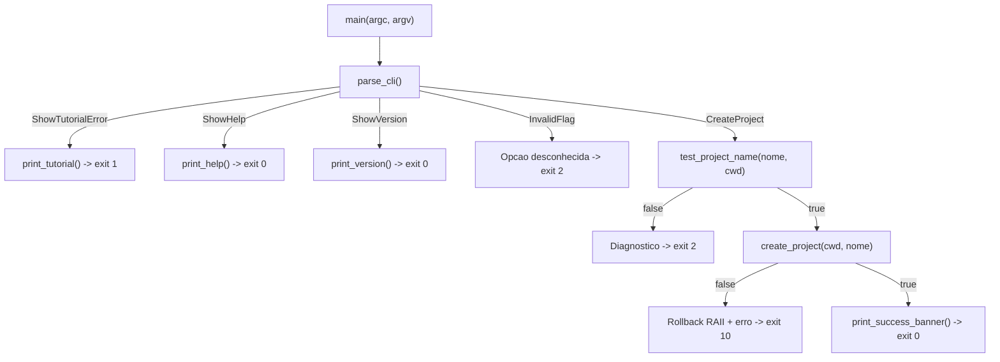

# 03 — Arquitetura C++23

[← Índice](00_indice.md)

## 1. Estrutura do repositório

```text
cpp-bootstrap/
├── .github/workflows/
│   ├── ci.yml                  # CI multiplataforma
│   └── release.yml             # Publicação de binários em tags v*
├── include/
│   ├── terminal.hpp            # SO, ANSI/VT e saída no terminal (header puro)
│   ├── cli.hpp                 # Parse de argumentos e telas de ajuda
│   ├── validator.hpp           # Validação do nome do projeto
│   ├── templates.hpp           # Templates embutidos (header puro)
│   └── generator.hpp           # Escrita em disco e rollback RAII
├── src/
│   ├── cli.cpp
│   ├── validator.cpp
│   ├── generator.cpp
│   └── main.cpp                # Ponto de entrada e mensagem final
├── tests/
│   └── test_cpp_bootstrap.cpp  # Suíte de 20 testes (CTest)
├── docs/                       # Esta documentação
├── CMakeLists.txt
├── AGENTS.md
└── README.md
```

Convenções:

- Tudo vive em `namespace bootstrap` (`bootstrap::term` para o terminal e `bootstrap::tpl` para os templates).
- Funções e variáveis em `snake_case`.
- Banners de seção no estilo `//====== [ SECAO ] ======` e comentários didáticos em português.
- Arquivos `.hpp`, `.cpp` e `CMakeLists.txt` só com ASCII 7-bit, em UTF-8 sem BOM e LF.

## 2. Responsabilidade de cada módulo

| Módulo | Responsabilidade | API principal |
| :--- | :--- | :--- |
| `terminal.hpp` | Saber em que SO está, se pode usar cores e como imprimir | `kVersion`, `detect_os_label()`, `should_use_ansi()`, `palette()`, `print_line()`, `print_separator()`, `write_info/warn/error()` |
| `cli` | Transformar `argv` em uma decisão (`CliAction`) | `parse_cli()`, `trim_project_name()`, `print_tutorial()`, `print_help()`, `print_version()` |
| `validator` | Dizer se um nome é seguro, imprimindo o diagnóstico | `test_project_name(name, base_dir, silent = false)` |
| `templates.hpp` | Guardar o conteúdo dos 5 arquivos gerados | `kLaunchJson`, `kSettingsJson`, `kMainCpp`, `kCmakeLists`, `kGitignore`, `render_cmake_lists()` |
| `generator` | Criar pastas e arquivos de forma transacional | `DirectoryRollbackGuard`, `write_utf8_no_bom()`, `create_project()` |
| `main.cpp` | Orquestrar tudo e devolver o código de saída | `main()`, `print_success_banner()` |

## 3. Fluxo de execução



## 4. Códigos de saída

| Código | Situação |
| :--- | :--- |
| `0` | Projeto criado, ou `--help` / `--version` |
| `1` | Executado sem argumentos (tutorial) |
| `2` | Nome inválido, nome já existente ou flag desconhecida |
| `10` | Falha de I/O durante a criação (a pasta parcial é removida) |

## 5. Regras de validação do nome

Aplicadas nesta ordem, iguais em Windows, Linux e macOS (para que o projeto possa ser clonado em qualquer sistema):

1. **Vazio ou só espaços** → `[ERRO] Nome do projeto vazio.`
2. **Termina com `.`** → inválido no Windows.
3. **Nome reservado do Windows** (`CON`, `PRN`, `AUX`, `NUL`, `COM1`–`COM9`, `LPT1`–`LPT9`, inclusive com extensão, como `NUL.txt`, e sem diferenciar maiúsculas).
4. **Fora de `^[A-Za-z0-9_][A-Za-z0-9_-]*$`** → lista os caracteres proibidos (`<espaco>`, `<ctrl>` ou o próprio caractere) ou `inicio com '-'`. Isso garante que `project(<Nome> LANGUAGES CXX)` nunca quebre o CMake.
5. **Já existe pasta ou arquivo** com o mesmo nome no diretório atual.

## 6. Pontos técnicos importantes

- **Modo binário na escrita:** `write_utf8_no_bom()` abre o arquivo com `std::ios::binary`. Sem isso, a CRT do Windows converteria `\n` em `\r\n`.
- **Sem mudar de diretório:** todos os caminhos são montados com `base_dir / nome`; o processo nunca chama `current_path(...)` para trocar de pasta.
- **Rollback RAII:** `DirectoryRollbackGuard` é criado logo após `create_directory()` da raiz. Se qualquer gravação lançar exceção, o destrutor remove a pasta com `remove_all` (versão `noexcept` com `std::error_code`).
- **Cores seguras:** com `stdout` redirecionado ou `NO_COLOR` definido, a `Palette` fica vazia e nenhuma sequência ANSI vaza para logs ou testes.
- **`<print>` opcional:** `print_line()` só usa `std::println` se `__cpp_lib_print` estiver definido, garantindo compilação em toolchains onde `<print>` ainda é incompleto (ex.: AppleClang).
