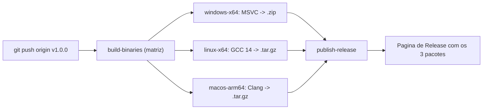

# 05 — CI/CD no GitHub Actions

[← Índice](00_indice.md)

GitHub Actions são arquivos `.yml` dentro de `.github/workflows/`. O GitHub os lê e executa os passos em máquinas virtuais quando acontece o evento configurado (um push, uma tag etc.).

## 1. `ci.yml` — testes automáticos

- **Quando roda:** `push` e `pull_request` na branch `main`.
- **O que faz:** compila em `Release`, roda `ctest` e depois a suíte completa com `--include-build`.
- **Matriz** (`fail-fast: false`, então uma falha não cancela as outras):

| Job | Máquina | Toolchain |
| :--- | :--- | :--- |
| Ubuntu 24.04 (GCC 14) | `ubuntu-24.04` | `g++-14` instalado via `apt` |
| Windows (MSVC) | `windows-latest` | Visual Studio da imagem |
| Windows (MSYS2 UCRT64 GCC) | `windows-latest` | `msys2/setup-msys2@v2` + gerador Ninja + runtime estático |
| macOS 15 (Clang) | `macos-15` | Clang do Xcode |

> [!NOTE]
> No Ubuntu é instalado o GCC 14 porque o compilador padrão da imagem pode não ter `<print>` completo.

Onde ver: aba **Actions** do repositório → workflow **CI**. Cada job mostra o log de cada passo.

## 2. `release.yml` — publicação de binários

- **Quando roda:** push de uma tag no formato `v*` (ex.: `v1.0.0`) ou manualmente (`workflow_dispatch`).
- **Permissão:** `contents: write`, necessária para criar a Release.

Etapas:



1. **`build-binaries`:** em cada plataforma, compila em `Release`, roda o `ctest` (um binário com defeito não é publicado) e empacota `cpp-bootstrap` + `README.md` como `cpp-bootstrap-<tag>-<plataforma>.zip` ou `.tar.gz`. Envia o pacote com `actions/upload-artifact@v4`.
2. **`publish-release`:** só roda se o evento for uma tag `v*`. Baixa os 3 pacotes e cria a Release com `softprops/action-gh-release@v2`, gerando as notas automaticamente a partir dos commits.

> [!TIP]
> Rodar o workflow manualmente (`workflow_dispatch`) compila e testa tudo com o nome `snapshot`, mas **não** publica Release. É útil para conferir os pacotes antes de criar a tag.

## 3. Como publicar a `v1.0.0`

1. Confirme que o último run do **CI** na `main` está verde.
2. Crie e envie a tag:

   ```powershell
   git tag -a v1.0.0 -m "release: cpp-bootstrap v1.0.0"
   git push origin v1.0.0
   ```

3. Acompanhe o workflow **Release** na aba Actions.
4. Ao terminar, a página **Releases** terá os 3 pacotes para download.

## 4. Se algo falhar

| Sintoma | Onde olhar |
| :--- | :--- |
| Um job do CI fica vermelho | Abra o job e o passo que falhou; o log do `ctest --output-on-failure` mostra qual teste quebrou |
| A Release não aparece | Verifique se a tag começa com `v` e se o job `build-binaries` passou nas 3 plataformas |
| Erro de linker com `<print>` no Linux | Confirme que o passo de instalação do `g++-14` rodou |
| Precisa refazer uma tag | `git tag -d v1.0.0`, `git push origin :refs/tags/v1.0.0`, apague a Release no GitHub e crie a tag de novo |
